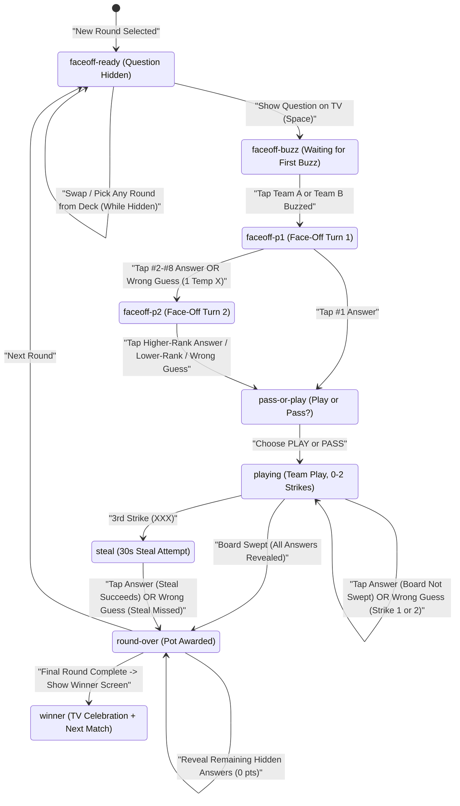

# 🎉 Party Feud — Live Party Multiplayer Game Engine

A zero-backend, multi-device **Party Feud** game show web app built to run directly on **GitHub Pages** (or locally by opening `index.html`)—complete with a PIN-locked **Host Remote**, a 16:9 **TV Display Board**, an optional **Fast Money Bonus Round**, a **Multi-Game Unplayed Round Slicer**, and a **Printable Question Review & `Used` Tracker** (`review.html`).

---

## ✨ Features

* **🖥️ Dual-Screen Live Game Engine (Host Remote + TV Display)**:
  * **Host Remote (PIN-Locked)**: Streamlined mobile-first & desktop workspace with a **slim merged header**, **Guided Phase Coach & collapsible Teleprompter (`🎙️ SCRIPT` / `HIDE` for `🎙️ SAY` / `👉 DO`)**, an **interactive Team Score Strip**, an **un-scrolled full Answer Key** paired side-by-side with an **embedded 16:9 Live TV Screen monitor** on desktop (stacking below on narrow screens), **tap-to-edit contextual popovers**, strict **phase-gated controls**, **`↩️ Undo`** (25-step snapshot stack), clickable answer key, single-answer reveal (`👁️ Reveal Answer #N`), `🔍 Be More Specific` (`+5s` when timer is running), 1-tap Fast Money scoring chips, live question editor, and **Lobby** opening in a new tab.
  * **TV Display (Auto-Launched Window or Separate Browser Tab)**: Widescreen 16:9 game board with 3D flipping tiles, Web Audio game show sound effects, live Face-Off & steal alert banners, giant red `X` strike overlays (also mirrored inside the Host's mini Live TV monitor), a timer that stays hidden unless started, and an explicit **Match Winner Celebration** stage triggered when the Host clicks **🏆 Show Winner Screen**.
* **🔄 Multi-Game Party Engine, Conditional Tie-Breaker & "Winner Stays On"**:
  * **Level-Preserving Unplayed Round Slicer**: Run 4–8+ consecutive games from a large question deck at the same party without repeating a question. Tracks played rounds & Fast Money sets in `localStorage` (marking a round as **Used** only once its question is revealed on TV), deals `3`, `4`, `5`, `6`, or `All` unused rounds per match (`🎲 Randomize by Level (1x→2x→3x)` by default), and lets you swap rounds from a `1x`/`2x`/`3x` tree while the question is still hidden.
  * **⚡ Conditional Sudden-Death Tie-Breaker**: A reserve Tie-Breaker round stays hidden unless both teams are tied at the end of regular rounds. Teams alternate until one picks the **`#1` answer** to win the match!
  * **🏁 Explicit Winner Screen & Next Match Setup**: When the final regular round (or Sudden-Death Tie-Breaker) ends, the board stays in `round-over` so the Host can reveal any remaining hidden answers (`0 pts`) to the crowd first. Clicking **🏆 Show Winner Screen** transitions the TV to the **🏆 Match Winner Celebration** and opens **Next Match Setup** (**👑 Winner Stays On**, **🔥 Rematch**, or **👥 Two New Teams**).
  * **⚡ Optional Fast Money**: Enable or disable the Fast Money bonus round per game inside `⚙️ Game Rules, Timer & PIN Options`.
* **🖨️ Printable Question Review & `Used` Manager (`review.html`)**:
  * Open [`review.html`](./review.html) (or click **🖨️ Review** inside **New Game Setup**) to inspect all rounds and Fast Money questions in a clean 2-column print layout, toggle per-round **`Used` / `Unused`** checkboxes (with **`☑️ Mark All Used`** / **`☐ Mark All Unused`** bulk buttons persisted in `localStorage`), switch decks, and copy shareable URLs like `review.html?deck=desi-thanksgiving`.
* **🔌 Hybrid Zero-Config Sync (`js/sync.js`)**:
  * **PeerJS (WebRTC P2P)** with automatic reconnect & heartbeat recovery for cross-device multiplayer over Wi-Fi/cellular with zero database setup.
  * **`BroadcastChannel` + `localStorage`** for 100% offline dual-window play on a single laptop plugged into a TV via HDMI.
  * **Optional Firebase Firestore** hook if you ever want cloud-persisted rooms.
* **📦 Bundled & Auto-Discovered Question Decks (`decks/catalog.js`)**:
  * **Auto-Populated GUI Deck Selector**: Bundled decks in `decks/catalog.js` work 100% offline over `file://`, and when hosted on GitHub Pages (`*.github.io`), any new `.json` or `.csv` file committed to the `/decks/` folder is discovered automatically via the GitHub API.
  * **Party Feud Deck JSON (`.json`)**: Configures `gameTitle`, `gameIcon` (emoji), `deckName`, `teamPresets`, `rounds`, and `fastMoney`.
  * **Direct URL Sharing**: Load any hosted CSV or JSON deck automatically via URL parameters:
    `?deck=https://.../my-questions.json&title=Holiday+Party+Feud&icon=🎉`

---

## 🚀 How to Play

### Mode A: Laptop + HDMI TV (Offline Dual-Window — Recommended)
1. Plug your laptop into the TV in **Extended Display** mode (works both on GitHub Pages and offline via `file://`).
2. On your laptop, click **✨ Create New Game Room** — a dedicated **TV Display** window (`?room=CODE&role=tv`) pops open automatically (or click **📺 Pop Out TV** inside `⋯` anytime).
3. Drag the TV window onto your TV screen and click **⛶ Fullscreen**. Both windows sync instantaneously via `BroadcastChannel` + `localStorage`—even with Wi-Fi turned off—while your Host screen keeps a live embedded 16:9 TV monitor.

### Mode B: Joining by Room Code (Separate Browser Window / Same Wi-Fi)
1. Open your URL on the Host device and click **✨ Create New Game Room** to generate a 4-character Room Code (e.g., `GA42`).
2. On the TV device/window, enter the Room Code under **📺 2. TV Display** and click **📺 Launch TV Board** (`?room=CODE&role=tv`). Each view preserves `?room=CODE&role=...` in its URL so a page refresh restores your session.

---

## 🎙️ Host Workflow State Machine & Timer Guide

The Host Remote enforces a **strict phase-only workflow** so only actions valid for the current game phase are enabled, backed by a **`↩️ Undo`** button in the top round bar.



### Allowed Actions by Phase

| Phase (`roundPhase`) | Answer Tiles | Primary Host Actions Allowed |
| :--- | :--- | :--- |
| **`faceoff-ready`** | 🔒 Locked | **👁️ Show Question on TV (`Space`)**, or tap the Host question box / round pill to **Randomize** or **Choose a Round from Deck** (`1x`/`2x`/`3x` tree) |
| **`faceoff-buzz`** | 🔒 Locked | **🔔 Team A Buzzed** or **🔔 Team B Buzzed** |
| **`faceoff-p1`** | 🔓 Unrevealed clickable | Tap revealed answer (`1`–`8`), **❌ Wrong Guess** (1 Temp X), or **🔍 Be More Specific** (`+5s`) |
| **`faceoff-p2`** | 🔓 Unrevealed clickable | Tap 2nd player's answer (`1`–`8`), **❌ Wrong Guess**, or **🔍 Be More Specific** (`+5s`) |
| **`pass-or-play`** | 🔒 Locked | **▶️ PLAY Board** or **🔀 PASS Board** |
| **`playing`** | 🔓 Unrevealed clickable | Tap board answer (`1`–`8`), **❌ Wrong Answer (`X`)**, **🔍 Be More Specific** (`+5s`), or **🔄 Start Timer (`R`)** |
| **`steal`** | 🔓 Unrevealed clickable | **⏱️ Start 30s Steal Timer (`R`)**, tap stolen answer (`1`–`8`), **❌ Steal Missed (`X`)**, or **🔍 Be More Specific** (`+5s`) |
| **`round-over`** | 🔓 Unrevealed clickable (`0 pts`) | **👁️ Reveal Answer #N (0 pts)**, **⏭️ Next Round ▶**, or **🏆 Show Winner Screen** (final round) |

> **Tip:** Already-revealed answer tiles stay locked to prevent accidental taps—use **`↩️ Undo`** in the header to step back at any time, or **tap any element directly** (Team Score Strip / TV team card, hidden question box, phase stepper, or `⏱️` timer pill) to open its quick override popover.

### Quick-Reference Cheat Sheet

| Phase | Host Action (Button or Shortcut) | Automatic Game Flow & TV Behavior |
| :--- | :--- | :--- |
| **1. New Game Setup** | Click **✨ Create New Game Room** | Select your question deck (and optionally click **🖨️ Review**), enter **Team Names**, and expand **⚙️ Game Rules, Timer & PIN Options** if needed. |
| **2. Start of Round** | Click **👁️ Show Question on TV** (`Space`) | Reveals the question on the TV. **No timer runs yet** (`faceoff-buzz`)—players have unlimited time until the first person buzzes in. |
| **3. Face-Off Buzz-In** | Tap **🔔 Team A Buzzed** or **🔔 Team B Buzzed** | Plays the Face-Off tone, advances to `faceoff-p1`, and **automatically starts their answer timer**. |
| **4. Face-Off Turn 1** | Tap their answer (`1`–`8`) or tap **❌ Wrong Guess** (`X`) | • **If `#1` Answer**: That team immediately wins the Face-Off (`pass-or-play`).<br>• **If `#2`–`#8` Answer**: Passes the turn to the opposing team (`faceoff-p2`).<br>• **If Wrong Guess (`X`)**: Flashes 1 temporary X on the TV (round strikes untouched), passes the turn to the opposing team (`faceoff-p2`), and **automatically starts their answer timer**. |
| **5. Face-Off Turn 2** | Tap 2nd player's answer (`1`–`8`) or tap **❌ Wrong Guess** (`X`) | Automatically compares ranks and advances to **`pass-or-play`** for the higher-ranking team! |
| **6. Play or Pass** | Click **▶️ PLAY** or **🔀 PASS** | Assigns board control (`playing`) and resets the timer for the playing team (press `R` to start the countdown for each player). |
| **7. Team Play (`0–3 X`)** | Tap answer (`1`–`8`) or **❌ Wrong (`X`)** | • **Correct answer or Strike 1/2**: Resets the Player Answer Timer to full duration (`R` to start, `T` to pause/resume).<br>• **Timer hits `0s` (`TIME!`)**: Sounds the time-up alert without forcing a transition—the Host can still tap a board answer, tap **❌ Wrong (`X`)**, or restart the timer.<br>• **Board Swept**: If all answers are revealed, awards the pot and enters `round-over`.<br>• **3rd Strike (`XXX`)**: **Automatically switches teams to `steal`**, shows **"CHANCE TO STEAL [POT] PTS!"** on the TV, and pre-loads the **30s Steal Timer**. |
| **8. Steal Mode (`30s`)** | Click **⏱️ Start 30s Steal Timer (`R`)**, then tap board answer or **❌ Steal Missed (`X`)** | • **If Answer on Board**: Reveals tile, awards the pot to the stealing team, and enters `round-over`.<br>• **If Wrong (`X`)**: Triggers `X`, awards the pot to the original playing team, and enters `round-over`. |
| **9. Round Complete** | Click **👁️ Reveal Answer #N (0 pts)**, then **⏭️ Next Round ▶** | Reveals remaining unflipped tiles one by one without affecting scores, then advances to the next round (where you can swap the round from the deck while the question is still hidden). |
| **10. Tie-Breaker / Match Winner** | Plays after the final regular round | • **If Tied (`T1 == T2`)**: Unlocks the **⚡ Sudden-Death Tie-Breaker** round—teams alternate until one picks the **`#1` answer** to win.<br>• **When a Team Wins**: Stays in `round-over` so you can reveal remaining hidden answers first, then click **🏆 Show Winner Screen** to celebrate on TV and open **Next Match Setup**. |

---

### 1. Creating a New Game (`🆕 New Game Setup`)
When you click **✨ Create New Game Room**, the **New Game Setup** modal walks you through 3 streamlined steps:
1. **Active Question Deck**:
   * Choose any deck from the dropdown (`deckName • XX Rounds • XX Fast Money`), or click **🖨️ Review** to open the printable review sheet & `Used`/`Unused` manager.
   * The **📊 Rounds Unused** badge shows how many questions remain unplayed in that deck across your party session (with a **↺ Reset Used** button to clear history anytime).
2. **Team Names**: Enter **Team 1** and **Team 2** names (or click **🎲 Swap Preset Names** to cycle through your deck's `teamPresets`).
3. **⚙️ Game Rules, Timer & PIN Options** *(collapsible)*: Choose **Rounds per Game** (`3`, `4`, `5`, `6`, or `All`), **Unplayed Round Selection** (`Randomize by Level`, `In Order by Level`, or `Random Shuffle`), **Include "Fast Money" Bonus Round**, **Player Answer Timer** (`5s`/`7s`/`10s`/`15s`), and **4-Digit Host PIN**.

---

### 2. Starting a Round & The Face-Off (Hidden Question → Unlimited Wait → First Buzz)
1. **Mystery Question State (`faceoff-ready`)**: Whenever a new round is selected, the question prompt on the **TV Display** starts **hidden** (`🔒 Question Hidden — Get Ready for the Face-Off!`) so players cannot read ahead while walking up to the podium. Meanwhile, the **Host Remote** displays the full question and answer key—and while hidden, you can **tap the question box** (or round pill) to randomize or pick another round from the `1x`/`2x`/`3x` tree.
2. **Reveal Question on TV (`Space`)**: Once one player from each team is ready, the Host clicks **👁️ Show Question on TV (`Space`)** and reads the question aloud. Revealing the question marks that round as **Used** in `localStorage`, and **no timer starts yet** (`faceoff-buzz`).
3. **Buzzing In & Face-Off Turns**:
   * Tap **🔔 Team A Buzzed First** or **🔔 Team B Buzzed First** on the Host screen. This plays the Face-Off tone and starts that team's shot-clock (`faceoff-p1`).
   * **Correct Answer**: Tap that answer on the Host Remote (`1`–`8`). The tile flips on the TV with a *Ding!*, points are added to the Round Pot, and the **timer automatically stops**.
   * **Wrong Guess or Not #1 Answer**: If the first player misses (**❌ Face-Off Wrong Guess**, 1 temp `X` with no round strike) or doesn't get `#1`, the turn passes to the opposing player (`faceoff-p2`) — and on a **Wrong Guess**, the timer **automatically starts** for that second player.
   * **Pass or Play**: Whichever team wins the Face-Off chooses to **Play** or **Pass** (`▶️ PLAY` / `🔀 PASS`).

---

### 3. Going Down the Line (Asking Each Team Member)
As the Host goes down the line asking each member of the playing team for an answer:
1. **Start Next Player's Clock**: Each time you ask the next team member the question, tap **🔄 Start Timer** (or press **`R`**). The timer resets to full duration (`10s`, `7s`, etc.) and immediately counts down (playing a clock tick during the final 5 seconds).
2. **If the Player Answers in Time**:
   * **On the Board**: Tap the matching answer button (`1`–`8`). The tile flips on the TV, points add to the Round Pot, and the timer resets.
   * **Wrong Answer**: Tap **❌ Wrong / X** (or press **`X`**). The Big Red `X` flashes on the TV & mini TV monitor, the strike counter increments, and the timer stops.
3. **If the Timer Hits `0` (`TIME!`)**:
   * The TV and Host Remote automatically sound the buzzer honk and flash `TIME!`. The Host can then tap **`X`** to issue a strike and press **`R`** for the next player.
4. **Pausing, "Be More Specific", or Adjusting Anything Anytime**:
   * **⏱️ Start / Pause / Resume Timer (`T`)**: Start, pause, or resume the shot-clock anytime; on the TV screen, the timer stays hidden unless started.
   * **🔍 Be More Specific**: Plays a gentle double-buzz and adds `+5s` if the timer is running.
   * **Tap-to-Edit Popovers**: Tap a **Team Card/Score** (name, exact score/`±1`/`±10`, make active, award pot), the **Phase Stepper** (board control & manual strikes `X`/`XX`/`XXX`), or the **`⏱️` Timer Pill** (duration `5s`/`7s`/`10s`/`15s`/`30s` or stop/reset).

---

### 4. Three Strikes & The 30-Second Steal
1. Once the playing team gets **3 Strikes (`XXX`)**:
   * The TV automatically switches to the opposing team with **`🚨 [Stealing Team]: CHANCE TO STEAL [POT] PTS!`** and pre-loads the shot-clock to **`30s`**.
2. **Steal Huddle Timer**: Click **⏱️ Start 30s Steal Timer (`R`)** to start the 30-second huddle countdown on the TV for the opposing team's single Steal attempt.
3. **Resolving the Round**:
   * **If the Steal Succeeds**: Tap the matching answer on the Host Remote—it flips, adds to the pot, and **automatically awards the pot to the stealing team**.
   * **If the Steal Misses**: Tap **❌ Steal Missed (`X`)**—triggers `X` and **automatically awards the pot to the original playing team**.
4. **Reveal Remaining Answers**: Click **👁️ Reveal Answer #N (0 pts)** to flip remaining unflipped answers one at a time on the TV without affecting the score, then click **⏭️ Next Round ▶**!

---

### 5. Fast Money Bonus Round (`⚡ Fast Money` — Optional)
If **Include "Fast Money" Bonus Round** was checked during game setup:
1. Click **⚡ Fast Money** on the Host Remote to switch the TV to the Fast Money board.
2. **Player 1 (20 Seconds)**: Player 2 steps out of the room/earshot. Click **`20s`** and **Start** to run the 20-second clock.
3. **1-Tap Answer & Score Chips**: Beneath each Fast Money question on the Host Remote, tap any survey chip (e.g., `[Turkey • 38]` or `[❌ 0 Pts]`) to auto-fill both the answer text and points in one tap (or type a custom answer and tap the matching score chip). Tapping `[❌ 0 Pts]` (or entering `0`) triggers the zero-point buzzer honk, while positive points play the reveal ding!
4. **Hide Player 1 & Run Player 2 (25 Seconds)**: Click **🙈 Hide/Show P1** so Player 1's answers are hidden on the TV, bring Player 2 back, click **`25s`**, and click **Start**. If Player 2 gives an identical answer to Player 1, tap **Dup ❌** to sound the duplicate-answer buzzer!

---

### 6. Ending a Match & Running Multiple Games at a Party (`🏆 Show Winner Screen`)
When the final round of a match finishes:
1. **Reveal Remaining Answers First**: The game stays in `round-over` so you can click **👁️ Reveal Answer #N (0 pts)** (or tap hidden tiles) to show any unguessed answers to the crowd.
2. **Show Winner Screen**: Click **🏆 Show Winner Screen** (or **🏁 End Match** in `⋯`) to transition the TV to the **🏆 Match Champion Celebration Screen** and open **Next Match Setup**:
   * **👑 1. Winner Stays On**: Keeps the winning team as Team 1 (resetting scores to `0` for the new match) and prompts you for the **New Challenger Team (Team 2)** name.
   * **🔥 2. Rematch (Same Teams)**: Keeps both **Team 1** and **Team 2** in their existing slots, resets scores to `0`, and deals a fresh set of unplayed rounds.
   * **👥 3. Two New Teams**: Prompts for two fresh team names (or lets you click **🎲 Swap Preset Pair**).
   * Click **🚀 Deal Next Unplayed Rounds & Start Match** to immediately deal the next slice of unused rounds and Fast Money questions.

---

## 📊 Deck JSON Schema & Adding New Decks to `/decks/`

A Party Feud Deck JSON file lets you customize the game title, emoji icon, deck name, team presets, rounds, and Fast Money questions:

```json
{
  "gameTitle": "Holiday Party Feud",
  "gameIcon": "🎉",
  "deckName": "Holiday Party Pack",
  "teamPresets": [
    ["Team A", "Team B"],
    ["Team Parents", "Team Kids"]
  ],
  "rounds": [
    {
      "theme": "🔥 Live Party Poll",
      "title": "Round 1",
      "multiplier": 1,
      "prompt": "Name something people always do right after finishing a huge meal.",
      "answers": [
        { "text": "Take a nap on the couch", "points": 40 },
        { "text": "Have coffee or tea", "points": 24 }
      ]
    }
  ],
  "fastMoney": [
    {
      "prompt": "Name a pizza topping almost everyone can agree on.",
      "hint": "Cheese (42), Pepperoni (30), Mushrooms (14), Olives (8), Peppers (6)"
    }
  ]
}
```

### How `/decks/` Discovery Works:
* **On GitHub Pages (`https://<user>.github.io/<repo>/`)**: Any `.json` or `.csv` file you commit to the `decks/` folder is **automatically discovered** via the GitHub Contents API and added to the **Select Question Deck** dropdown!
* **Offline (`file://`)**: Register new decks in [`decks/catalog.js`](./decks/catalog.js) so they work instantaneously without a web server.

---

## 📁 Repository Structure

```text
feud/
├── index.html                      # Main app UI (Lobby, TV Display, Host Remote, Modals)
├── review.html                     # Printable 2-column question review sheet (?deck=...)
├── css/
│   └── styles.css                  # Responsive game show styling & 3D tile animations
├── data/
│   └── questions.js                # Generic default starter deck & configuration
├── js/
│   ├── app.js                      # Controller, keyboard shortcuts & modal handlers
│   ├── state.js                    # State management, multi-game slicer & localStorage
│   ├── sync.js                     # PeerJS (WebRTC) + BroadcastChannel + Firebase sync
│   ├── formats.js                  # Universal CSV, Friendly-Feud JSON & Deck parser/exporter
│   ├── views.js                    # DOM renderers for TV Display and Host Remote
│   └── audio.js                    # Web Audio API synthesizer (no external MP3 dependencies)
└── decks/
    ├── catalog.js                          # Built-in deck registry for offline (file://) + online use
    ├── 2025.json                           # Family Feud 2025 (60 Rounds • 8 Fast Money Sets)
    ├── 2025-family-friendly.json           # Family Feud 2025 (Family-Friendly Edition)
    ├── 2026.json                           # Family Feud 2026 (60 Rounds • 8 Fast Money Sets)
    ├── 2026-family-friendly.json           # Family Feud 2026 (Family-Friendly Edition)
    ├── desi-thanksgiving.json              # 37-Round + 25 Fast Money Desi Thanksgiving Party Pack
    ├── gandhi-samaj-2026.json              # Gandhi Samaj 2026 (43 Rounds • 6 Fast Money Sets)
    ├── gandhi-samaj-2026-meha-edition.json # Gandhi Samaj 2026 (Meha Edition • 21 Rounds)
    ├── sample-friendly-feud.json           # Sample Friendly-Feud compatible JSON pack
    └── template.csv                        # Sample spreadsheet template for Google Sheets / Excel
```

---

## 🌐 Deploying Your Own Copy on GitHub Pages

1. Fork this repository on GitHub.
2. Go to **Settings → Pages**.
3. Under **Build and deployment**, select **Deploy from a branch** → `main` → `/ (root)` and click **Save**.
4. Your live multiplayer Party Feud site will be ready at `https://<your-username>.github.io/<repo-name>/`!

## 📄 License

Released under the [MIT License](./LICENSE).
