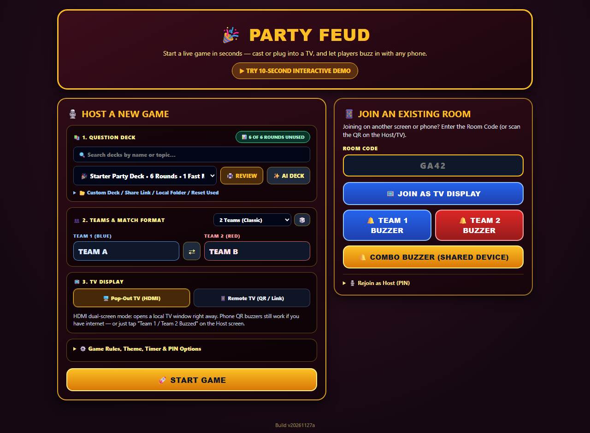
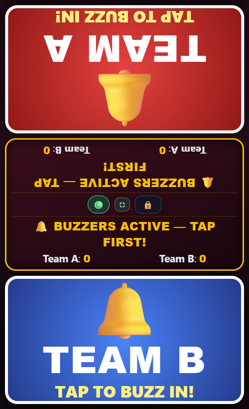
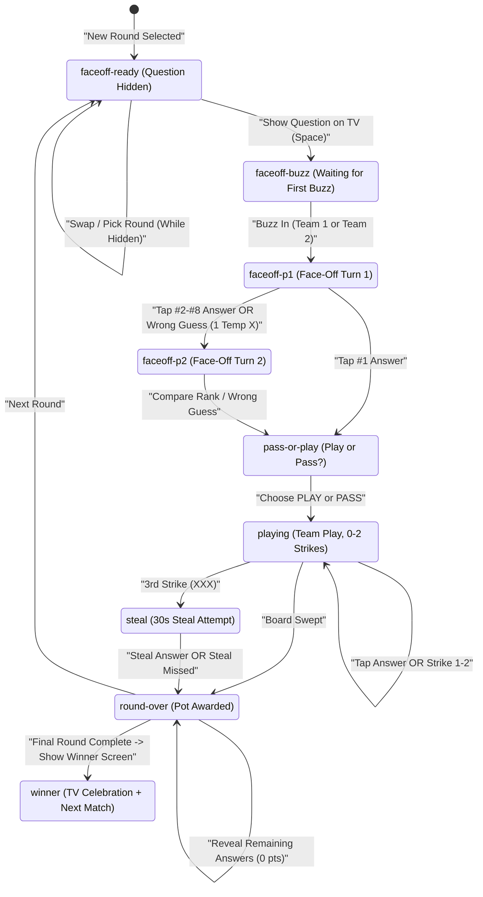

# 🎉 Party Feud — Host Your Own Live Game Show

Turn your TV, laptop, and phones into a real **Family Feud–style party game show** in seconds — no app installs, no accounts, and no setup headaches.

Pick from **300+ built-in survey rounds**, cast or plug in a TV, hand phones to both teams as live buzzers (or share one phone in the middle for 1v1 **Combo Buzzer** mode), and host like a pro with a built-in teleprompter, game-show sound effects, and one-tap **Undo**.

[](https://browngenius.github.io/feud)
[](https://browngenius.github.io/feud/review.html)


<p align="center">
  
</p>

---

## 📸 See It in Action

| Lobby & Room Setup | Host Control Screen + Mini TV |
| :---: | :---: |
|  |  |

| 16:9 TV Display Board | Printable Question Review Sheet |
| :---: | :---: |
|  |  |

| Individual Team Buzzer (Phone) | Combo Buzzer (Shared 1v1 Phone) |
| :---: | :---: |
|  |  |

---

## 🎴 Jump Right In — Ready-to-Play Question Packs

Launch straight into any bundled question deck with one click — or open the printable **Review** sheet to preview rounds and mark favorites ahead of time:

| Question Pack | Content | Play Live | Review Sheet |
| :--- | :--- | :---: | :---: |
| **🔥 Family Feud 2026** | 60 Rounds • 8 Fast Money Sets | [▶ Play](https://browngenius.github.io/feud/?deck=2026) | [🖨️ Review](https://browngenius.github.io/feud/review.html?deck=2026) |
| **🌟 Family Feud 2026 (Family-Friendly)** | 60 Clean All-Ages Rounds | [▶ Play](https://browngenius.github.io/feud/?deck=2026-family-friendly) | [🖨️ Review](https://browngenius.github.io/feud/review.html?deck=2026-family-friendly) |
| **⭐ Family Feud 2025** | 60 Rounds • 8 Fast Money Sets | [▶ Play](https://browngenius.github.io/feud/?deck=2025) | [🖨️ Review](https://browngenius.github.io/feud/review.html?deck=2025) |
| **🌟 Family Feud 2025 (Family-Friendly)** | 60 Clean All-Ages Rounds | [▶ Play](https://browngenius.github.io/feud/?deck=2025-family-friendly) | [🖨️ Review](https://browngenius.github.io/feud/review.html?deck=2025-family-friendly) |
| **🤖 2026 FRC Game & Rules** | 24 FIRST Robotics Competition Rounds | [▶ Play](https://browngenius.github.io/feud/?deck=2026-frc-rules) | [🖨️ Review](https://browngenius.github.io/feud/review.html?deck=2026-frc-rules) |
| **🦃 Desi Thanksgiving** | 37 Rounds • 5 Fast Money Sets | [▶ Play](https://browngenius.github.io/feud/?deck=desi-thanksgiving) | [🖨️ Review](https://browngenius.github.io/feud/review.html?deck=desi-thanksgiving) |
| **🎉 Starter Party Deck** | 6 Classic Party Rounds • Fast Money | [▶ Play](https://browngenius.github.io/feud/?deck=starter) | [🖨️ Review](https://browngenius.github.io/feud/review.html?deck=starter) |

---

## 🎯 Great For…

* **🏡 Family Game Nights & Holiday Parties:** Play right on the living-room TV in under a minute — grandma, kids, and guests just scan a QR code on any phone to buzz in.
* **🏫 Classrooms & Review Days:** Zero student logins, zero accounts, and zero data collection. Works on school projectors, Chromebooks, and phones with custom spreadsheet review decks.
* **💼 Office Team Building & Socials:** Turn an all-hands meeting room or Zoom screen-share into an energizing game show with built-in Host teleprompter cues.
* **🤖 Robotics Teams & Clubs (`FRC`):** Includes a dedicated **24-round 2026 FRC Game & Rules** deck for kickoff meetings, rookie onboarding, and drive-team prep.
* **🏕️ Offline Cabin & HDMI Parties:** Open `index.html` locally with Wi-Fi turned off and run Host + TV side-by-side over an HDMI cable.

---

## ⚖️ Why Party Feud vs. PowerPoint or Paid Apps?

| Feature | 🎉 Party Feud | 📊 PowerPoint Templates | 💸 Paid / Ad-Supported Web Apps |
| :--- | :---: | :---: | :---: |
| **Cost & Accounts** | **100% Free, Open Source, Zero Logins** | Often paid + requires Office/PowerPoint | Subscriptions, limits, or ads |
| **Live Phone Buzzers** | **QR Scan — Team 1, Team 2 & Shared Combo** | ❌ None (honor system / yelling) | ⚠️ Separate buzzer app or paid tier |
| **Host Controls** | **Full Answer Key, Live Mini TV, Teleprompter & 25-Step Undo** | ❌ Clunky slide presenter view | ⚠️ Basic host toggles |
| **TV Presentation & SFX** | **3D Flipping Tiles, Game-Show Audio, Big Red `X`, Winner Screen** | ⚠️ Static slides, manual point math | ✅ Varies |
| **Custom Decks & No Repeats** | **300+ Built-In Rounds, AI/CSV/JSON Decks & Multi-Game Used Tracker** | ❌ Hard to edit slides | ⚠️ Locked or paywalled |
| **Offline Mode** | **Works Offline Over HDMI (`file://`)** | ✅ Local file | ❌ Requires internet server |

---

## ✨ Why Hosts & Players Love It

* **📺 Real TV Show Presentation:** Big 16:9 board with flipping answer tiles, giant red `X` strike overlays, suspenseful countdown timer, game-show dings/buzzers/fanfare, and a **Match Champion** celebration screen.
* **🎙️ Stress-Free Hosting:** The Host screen shows all survey answers, a **live mini TV preview**, a **step-by-step coach**, a collapsible **Host Script** (`SAY` / `DO`), and a **25-step Undo** button so you can fix any mis-tap instantly.
* **🔔 Phone Buzzers (No App Required):** Scan a QR code from the TV or Host screen to join as **Team 1 Buzzer**, **Team 2 Buzzer**, or **Combo Buzzer** (both teams on one shared phone/iPad facing each other). Buzzers stay locked until you reveal the question!
* **🔄 Play All Night Without Repeats:** Tracks which questions you've already played across multiple games at the same party, includes a **printable Question Review Sheet** (`review.html`), and automatically unlocks a **Sudden-Death Tie-Breaker** if a match ends in a tie.
* **⚡ Optional Fast Money Bonus Round:** Toggle Fast Money on or off for any game, complete with 20s / 25s clocks, hidden Player 1 answers, duplicate-answer buzzers, and 1-tap score chips.

---

## 🚀 Quick Start (Play in 60 Seconds)

### Option 1: Party Setup (TV + Phone Buzzers via QR Code)
1. Open **[Party Feud](https://browngenius.github.io/feud)** on your laptop or tablet and tap **✨ Create New Game Room**.
2. Choose a question deck, enter your team names, and tap **🚀 Start New Game**.
3. Pick how to show the TV board:
   * **Start Local TV Screen Window** (if your laptop is plugged into a TV via HDMI), or
   * **Show QR Code for Remote TV Screen** (scan on a smart TV/casting laptop — it disappears automatically once connected).
4. Tap **📱 Join QR** anytime to put **Individual Buzzers** (Team 1 on the left, Team 2 on the right) or **Combo Buzzer** up on the TV for players to scan.

### Option 2: Laptop + HDMI TV (Works Even Offline)
1. Plug your laptop into your TV in **Extended Display** mode (works even with Wi-Fi turned off by opening `index.html`).
2. Start a room, pick **1. Start Local TV Screen Window**, drag that window onto your TV, and click **⛶ Fullscreen**.

---

## 🎙️ How a Round Works (Host Guide)

1. **Mystery Question → Show Question (`Space`):** New rounds keep the question hidden on the TV so players can't read ahead. Once both podium players are ready, click **👁️ Show Question on TV** (`Space`) — buzzers unlock with no timer running yet.
2. **Face-Off Buzz-In:** First team to buzz gets the shot clock.
   * **`#1` Answer:** Instantly wins the Face-Off!
   * **`#2`–`#8` Answer or Wrong Guess (`❌`):** Flashes 1 temporary `X` (without adding a round strike) and automatically starts the timer for the opposing player to try to beat it.
3. **Play or Pass:** The Face-Off winner chooses **▶️ PLAY** or **🔀 PASS**.
4. **Going Down the Line (`R` / `X`):** Press **`R`** to start each player's clock, tap matching answers (`1`–`8`) to flip them into the Round Pot, or press **`X`** for a wrong guess.
   * **Need clarification?** Tap **🔍 Be More Specific** for a gentle double-buzz and `+5s` on the clock.
   * **3 Strikes (`XXX`):** Automatically switches to the opposing team for a **30-second Steal**! If they hit an unrevealed answer, they steal the whole pot; if they miss, the original team keeps it.
5. **Round Over & Winner Screen:** Reveal any remaining unguessed answers (`0 pts`) to the crowd, then click **⏭️ Next Round** — or after the final round, click **🏆 Show Winner Screen** to celebrate and start the next match (**Winner Stays On**, **Rematch**, or **Two New Teams**).

---

## ✍️ Build Your Own Deck in 2 Minutes (AI or Spreadsheet)

Want custom questions for a birthday, wedding shower, classroom quiz, or club night? Create your own pack in two minutes using AI or a spreadsheet:

### Option A — Generate a Custom Deck with ChatGPT / Gemini / Claude
Copy and paste this prompt into your favorite AI assistant (just swap out the topic and audience):

```text
Create a Party Feud JSON deck for [TOPIC / EVENT, e.g. "90s Movies & Pop Culture" or "AP Biology Review"] with 12 rounds (4 at multiplier 1, 4 at multiplier 2, 4 at multiplier 3) and 5 Fast Money questions.

Follow this exact JSON schema and output raw JSON only:
{
  "gameTitle": "Party Feud",
  "gameIcon": "🎉",
  "deckName": "My Custom Deck (12 Rounds)",
  "teamPresets": [
    ["Team Alpha", "Team Omega"],
    ["Team A", "Team B"]
  ],
  "rounds": [
    {
      "theme": "🎬 Category Emoji + Name",
      "title": "Round 1",
      "multiplier": 1,
      "prompt": "Survey question prompt...",
      "answers": [
        { "text": "Top answer", "points": 40 },
        { "text": "Second answer", "points": 25 },
        { "text": "Third answer", "points": 18 },
        { "text": "Fourth answer", "points": 11 },
        { "text": "Fifth answer", "points": 6 }
      ]
    }
  ],
  "fastMoney": [
    {
      "prompt": "Quick 20-second survey question...",
      "hint": "Top Answer (45), Second (30), Third (15), Fourth (10)"
    }
  ]
}

Rules:
- Each round must have 4 to 8 concise answers ordered highest to lowest, with points totaling 100.
- Use "multiplier": 1 for rounds 1-4, 2 for rounds 5-8, and 3 for rounds 9-12.
```

**Play your generated deck right away:**
1. **Instant URL Load (No Fork Required):** Paste the JSON into a public [GitHub Gist](https://gist.github.com/), click **Raw**, copy the URL, and open:
   `https://browngenius.github.io/feud/?deck=YOUR_RAW_GIST_URL`
2. **Self-Host in Your Fork:** Save the `.json` file into your fork's `/decks/` folder on GitHub Pages — Party Feud automatically discovers new `.json` and `.csv` files in `/decks/` via the GitHub Contents API! (For offline `file://` play, click **`📂 Scan Folder`** or **`📄 Load Deck File`** in New Game Setup or Review to scan your local `/decks` folder directly from disk.)

### Option B — Edit in Google Sheets or Excel
* Download [`decks/template.csv`](./decks/template.csv) and fill in your questions, multipliers (`1` / `2` / `3`), answers, and points in Google Sheets or Excel.
* Publish your Google Sheet to the web as **CSV** and launch it directly with `?deck=YOUR_PUBLISHED_CSV_URL`, or drop the `.csv` file into `/decks/` on your GitHub Pages fork.
* Already have decks built for *Friendly-Feud* (`rounds[].ans` / `pnt` + `final_round`)? Those JSON files work automatically via URL, `/decks/`, **`📂 Scan Folder`**, or **`📄 Load Deck File`** too!

> **🤝 Contribute a Question Pack:** Made a great themed deck (Movies, Sports, Holiday Trivia, Classroom Review, Pop Culture)? **No JavaScript needed!** Open a Pull Request adding your `.json` or `.csv` file to `/decks/`, or share it in a GitHub Issue so other hosts can play it too.

---

## 🛠️ For Developers & Self-Hosting

<details>
<summary><strong>🔌 Hybrid Zero-Config Sync Architecture (WebRTC P2P + MQTT + Offline)</strong></summary>

Party Feud runs 100% statically with zero required backend or accounts (`js/sync.js`):

* **Parallel Race on Remote Clients (`https://`):** Remote buzzers and remote TVs race **Trystero WebRTC P2P** (multi-relay Nostr `wss://` signaling on port `443`) and **MQTT-over-WSS** (`wss://broker.emqx.io:8084/mqtt`, with `wss://test.mosquitto.org:8081/mqtt` fallback) in parallel so phones connect in ~1–2 seconds even behind restrictive mobile NATs/firewalls, cleanly tearing down the slower transport once the first handshake succeeds.
* **Automatic MQTT Fallback (`http://` / non-secure contexts):** Automatically uses MQTT-over-WSS when running on plain `http://` LAN servers where browsers restrict `crypto.subtle`. Strips `pin` and full `customDeck` payloads on MQTT broadcasts and uses MQTT Last Will + 2s/6.5s heartbeats for fast disconnect detection.
* **`BroadcastChannel` + `localStorage`:** Instant zero-network sync for dual-window HDMI / `file://` play, plus `?room=CODE&role=...` URL state preservation on reload.
* **Optional Firebase Firestore:** Drop a `window.FIREBASE_CONFIG` object in to enable cloud-persisted rooms.

</details>

<details>
<summary><strong>🔄 Host Workflow State Machine & Phase Gating Table</strong></summary>



| Phase (`roundPhase`) | Answer Tiles | Primary Host Actions Allowed |
| :--- | :--- | :--- |
| **`faceoff-ready`** | 🔒 Locked | **👁️ Show Question on TV (`Space`)**, or tap the Host question box / round pill to swap or randomize rounds (`1x`/`2x`/`3x` tree) |
| **`faceoff-buzz`** | 🔒 Locked | **🔔 Team A Buzzed** or **🔔 Team B Buzzed** (remote buzzers unlocked) |
| **`faceoff-p1`** | 🔓 Unrevealed clickable | Tap revealed answer (`1`–`8`), **❌ Wrong Guess** (1 Temp X + auto-starts Turn 2 timer), or **🔍 Be More Specific** (`+5s`) |
| **`faceoff-p2`** | 🔓 Unrevealed clickable | Tap 2nd player's answer (`1`–`8`), **❌ Wrong Guess**, or **🔍 Be More Specific** (`+5s`) |
| **`pass-or-play`** | 🔒 Locked | **▶️ PLAY Board** or **🔀 PASS Board** |
| **`playing`** | 🔓 Unrevealed clickable | Tap board answer (`1`–`8`), **❌ Wrong Answer (`X`)**, **🔍 Be More Specific** (`+5s`), or **🔄 Start Timer (`R`)** |
| **`steal`** | 🔓 Unrevealed clickable | **⏱️ Start 30s Steal Timer (`R`)**, tap stolen answer (`1`–`8`), **❌ Steal Missed (`X`)**, or **🔍 Be More Specific** (`+5s`) |
| **`round-over`** | 🔓 Unrevealed clickable (`0 pts`) | **👁️ Reveal Answer #N (0 pts)**, **⏭️ Next Round ▶**, or **🏆 Show Winner Screen** (final round) |

> **Host Shortcuts & Popovers:** Tap any Team Score Card, the Phase Stepper, or the `⏱️` Timer Pill directly to open contextual override popovers.

</details>

<details>
<summary><strong>📊 Deck JSON Schema, Auto-Discovery & URL Parameters</strong></summary>

A Party Feud Deck JSON file configures `gameTitle`, `gameIcon`, `deckName`, `teamPresets`, `rounds`, and `fastMoney`:

```json
{
  "gameTitle": "Holiday Party Feud",
  "gameIcon": "🎉",
  "deckName": "Holiday Party Pack",
  "teamPresets": [
    ["Team A", "Team B"],
    ["Team Parents", "Team Kids"]
  ],
  "rounds": [
    {
      "theme": "🔥 Live Party Poll",
      "title": "Round 1",
      "multiplier": 1,
      "prompt": "Name something people always do right after finishing a huge meal.",
      "answers": [
        { "text": "Take a nap on the couch", "points": 40 },
        { "text": "Have coffee or tea", "points": 24 }
      ]
    }
  ],
  "fastMoney": [
    {
      "prompt": "Name a pizza topping almost everyone can agree on.",
      "hint": "Cheese (42), Pepperoni (30), Mushrooms (14), Olives (8), Peppers (6)"
    }
  ]
}
```

* **GitHub Pages & HTTP Auto-Discovery:** Any `.json` or `.csv` file committed to `/decks/` is automatically discovered via the GitHub Contents API (on `*.github.io`) or `./decks/` directory listing (on local HTTP dev servers).
* **Offline (`file://`) Folder Scan & Custom Deck Files:** Use **`📂 Scan Folder`** (`showDirectoryPicker` + IndexedDB handle persistence for 1-click **`🔄 Re-scan`**, with `<input webkitdirectory>` fallback) to scan your local `/decks` folder directly from disk, or **`📄 Load Deck File`** to load individual custom `.json`/`.csv` decks — cached across reloads and between [`index.html`](./index.html) and [`review.html`](./review.html).
* **Direct URL Loading:** `?deck=2026-frc-rules` (bundled `/decks` slug) or `?deck=https://.../my-questions.json&title=Holiday+Party+Feud&icon=🎉` (CORS-accessible remote `.json`/`.csv`).
* **Printable Review & `Used` Tracker:** Open [`review.html`](./review.html) (or `review.html?deck=desi-thanksgiving`) to inspect all rounds/Fast Money sets, scan local folders or load custom files, and toggle `Used` / `Unused` status in `localStorage`.

</details>

<details>
<summary><strong>📁 Repository Structure</strong></summary>

```text
feud/
├── index.html                      # Main app UI (Lobby, TV Display, Host Remote, Buzzers, Modals)
├── review.html                     # Printable 2-column question review sheet (?deck=...)
├── AGENT.md                        # AI/developer workflow, conventions & cache-busting guide
├── css/
│   └── styles.css                  # Responsive game show styling & 3D tile animations
├── data/
│   └── questions.js                # Generic default starter deck & configuration
├── docs/
│   └── screenshots/                # Gameplay demo GIF & screenshots embedded in README.md
├── js/
│   ├── app.js                      # Controller, keyboard shortcuts & modal handlers
│   ├── state.js                    # State management, multi-game slicer & localStorage
│   ├── sync.js                     # Trystero WebRTC P2P + MQTT-WSS + BroadcastChannel + Firebase sync
│   ├── formats.js                  # Universal CSV, Friendly-Feud JSON & Deck parser/exporter
│   ├── decks.js                    # Local folder scanner (File System Access API), custom file loader & auto-discovery
│   ├── views.js                    # DOM renderers for TV Display, Host Remote, and Buzzers
│   └── audio.js                    # Web Audio API synthesizer (no external MP3 dependencies)
└── decks/
    ├── 2025.json                           # Family Feud 2025 (60 Rounds • 8 Fast Money Sets)
    ├── 2025-family-friendly.json           # Family Feud 2025 (Family-Friendly Edition)
    ├── 2026.json                           # Family Feud 2026 (60 Rounds • 8 Fast Money Sets)
    ├── 2026-family-friendly.json           # Family Feud 2026 (Family-Friendly Edition)
    ├── 2026-frc-rules.json                 # 2026 FRC Game & Rules (24 Rounds)
    ├── desi-thanksgiving.json              # 37-Round + 5 Fast Money Desi Thanksgiving Party Pack
    ├── sample-friendly-feud.json           # Sample Friendly-Feud compatible JSON pack
    └── template.csv                        # Sample spreadsheet template for Google Sheets / Excel
```

</details>

### 🌐 Deploying Your Own Copy on GitHub Pages
1. Fork this repository on GitHub.
2. Go to **Settings → Pages**.
3. Under **Build and deployment**, select **Deploy from a branch** → `main` → `/ (root)` and click **Save**.
4. Your live Party Feud site will be ready at `https://<your-username>.github.io/<repo-name>/`!

## 📄 License

Released under the [MIT License](./LICENSE).
