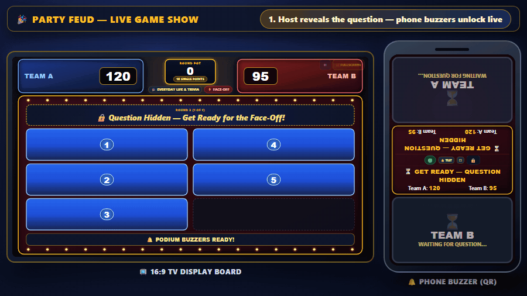
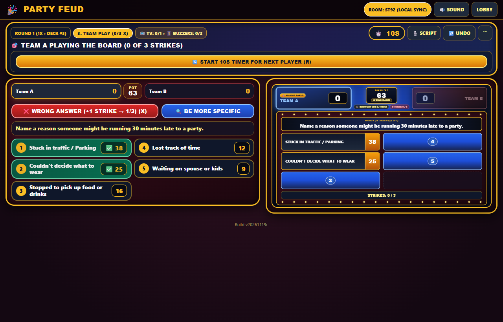
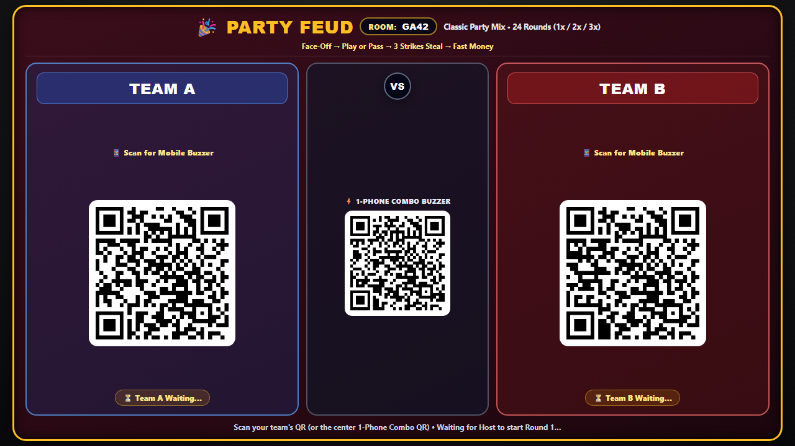
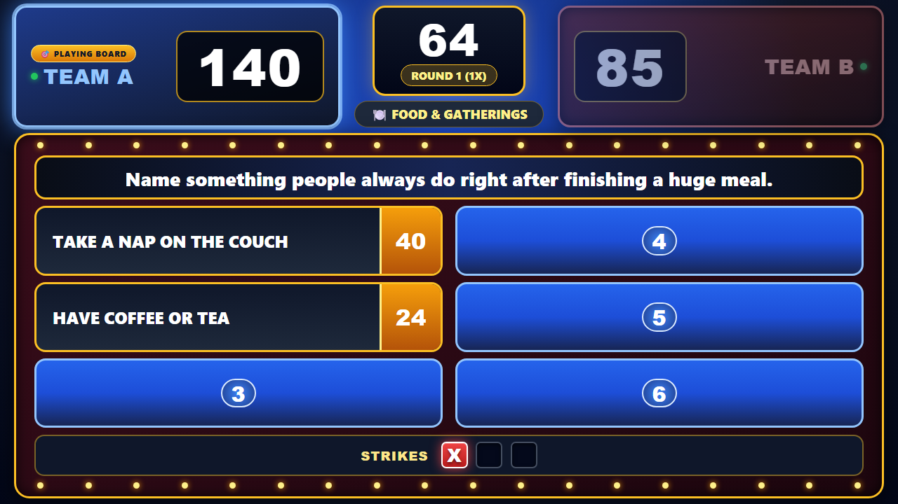
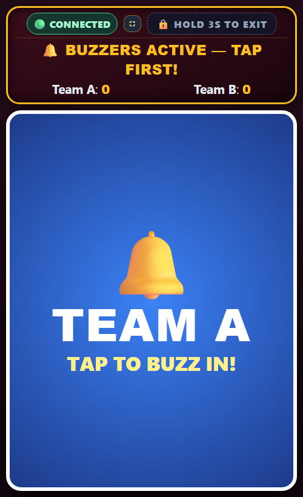
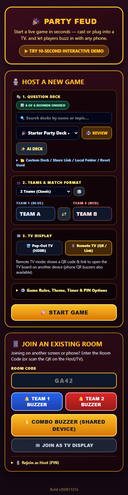
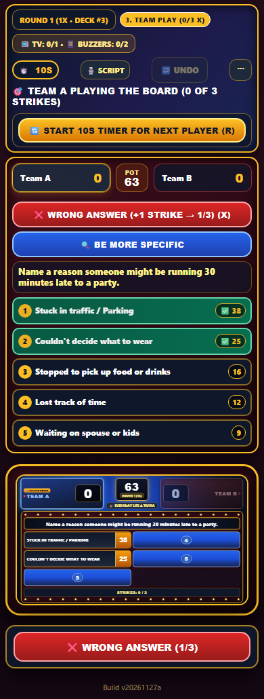
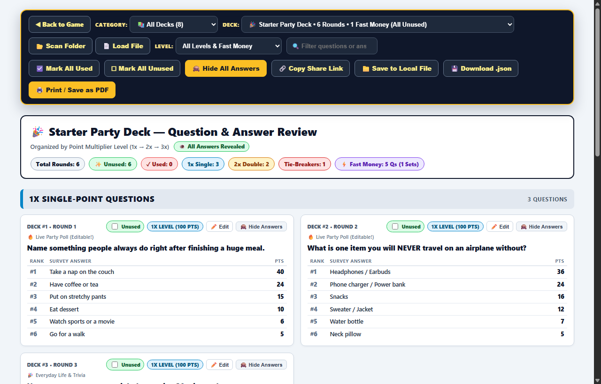
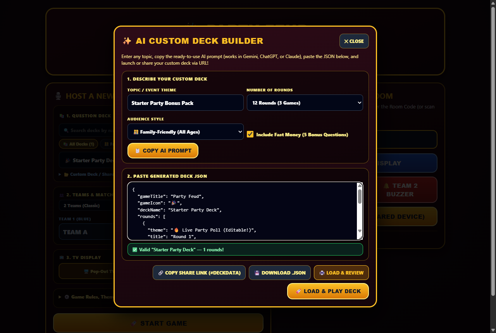
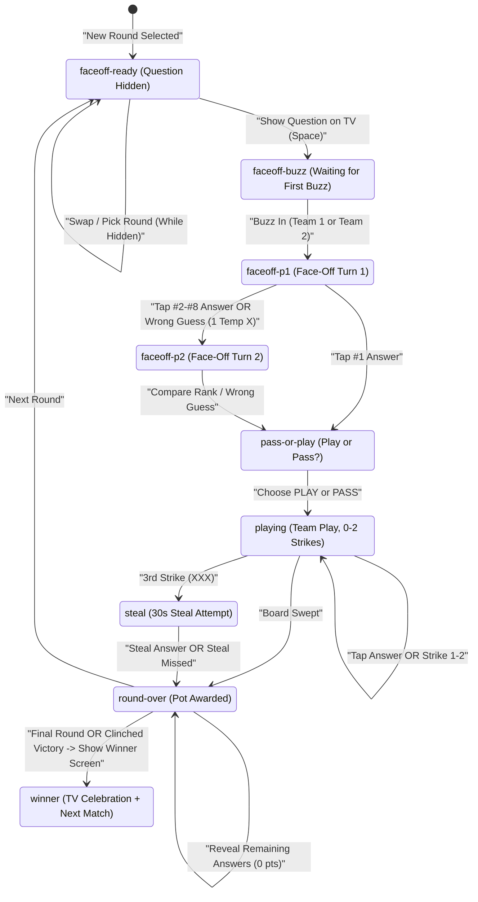

# 🎉 Party Feud — Host Your Own Live Game Show

Turn your TV, laptop, and phones into a real **Family Feud–style party game show** in seconds — no app installs, no accounts, and no setup headaches.

Pick from **300+ built-in survey rounds**, cast or plug in a TV, hand phones to both teams as live buzzers (or share one phone in the middle for 1v1 **Combo Buzzer** mode), and host like a pro with a built-in teleprompter, game-show sound effects, and one-tap **Undo**.

[](https://browngenius.github.io/feud)
[](https://browngenius.github.io/feud/review.html)


<p align="center">
  
</p>

---

## 📸 See It in Action

| Lobby & Room Setup | Host Control Screen + Mini TV |
| :---: | :---: |
|  |  |

| 16:9 TV Welcome Screen (Split QRs) | 16:9 TV Display Board |
| :---: | :---: |
|  |  |

| Individual Team Buzzer (Phone) | Combo Buzzer (Shared 1v1 Phone) |
| :---: | :---: |
|  |  |

| Mobile Lobby (Buzzer-First Join) | Mobile Host Control (Sticky Action Bar) |
| :---: | :---: |
|  |  |

| Printable Question Review Sheet | |
| :---: | :---: |
|  | |

---

## 🎴 Jump Right In — Ready-to-Play Question Packs

Launch straight into any bundled question deck with one click — or open the printable **Review** sheet to preview rounds and mark favorites ahead of time:

| Question Pack | Content | Play Live | Review Sheet |
| :--- | :--- | :---: | :---: |
| **🔥 Family Feud 2026** | 60 Rounds • 8 Fast Money Sets | [▶ Play](https://browngenius.github.io/feud/?deck=2026) | [🖨️ Review](https://browngenius.github.io/feud/review.html?deck=2026) |
| **🌟 Family Feud 2026 (Family-Friendly)** | 60 Clean All-Ages Rounds | [▶ Play](https://browngenius.github.io/feud/?deck=2026-family-friendly) | [🖨️ Review](https://browngenius.github.io/feud/review.html?deck=2026-family-friendly) |
| **⭐ Family Feud 2025** | 60 Rounds • 8 Fast Money Sets | [▶ Play](https://browngenius.github.io/feud/?deck=2025) | [🖨️ Review](https://browngenius.github.io/feud/review.html?deck=2025) |
| **🌟 Family Feud 2025 (Family-Friendly)** | 60 Clean All-Ages Rounds | [▶ Play](https://browngenius.github.io/feud/?deck=2025-family-friendly) | [🖨️ Review](https://browngenius.github.io/feud/review.html?deck=2025-family-friendly) |
| **🤖 2026 FRC Game & Rules** | 24 FIRST Robotics Competition Rounds | [▶ Play](https://browngenius.github.io/feud/?deck=2026-frc-rules&theme=frc) | [🖨️ Review](https://browngenius.github.io/feud/review.html?deck=2026-frc-rules) |
| **🦃 Desi Thanksgiving** | 37 Rounds • 5 Fast Money Sets | [▶ Play](https://browngenius.github.io/feud/?deck=desi-thanksgiving) | [🖨️ Review](https://browngenius.github.io/feud/review.html?deck=desi-thanksgiving) |
| **🎬 Bollywood Music & Movies** | 12 Rounds • Fast Money | [▶ Play](https://browngenius.github.io/feud/?deck=bollywood-music-movies) | [🖨️ Review](https://browngenius.github.io/feud/review.html?deck=bollywood-music-movies) |
| **🎉 Starter Party Deck** | 6 Classic Party Rounds • Fast Money | [▶ Play](https://browngenius.github.io/feud/?deck=starter) | [🖨️ Review](https://browngenius.github.io/feud/review.html?deck=starter) |

---

## 🎯 Great For…

* **🏡 Family Game Nights & Holiday Parties:** Play right on the living-room TV in under a minute — grandma, kids, and guests just scan a QR code on any phone to buzz in.
* **🏫 Classrooms & Review Days:** Zero student logins, zero accounts, and zero data collection. Works on school projectors, Chromebooks, and phones with custom AI-generated JSON review decks.
* **💼 Office Team Building & Socials:** Turn an all-hands meeting room or Zoom screen-share into an energizing game show with built-in Host teleprompter cues.
* **🤖 Robotics Teams & Clubs (`FRC`):** Includes a dedicated **24-round 2026 FRC Game & Rules** deck for kickoff meetings, rookie onboarding, and drive-team prep.
* **🏕️ Offline Cabin & HDMI Parties:** Open `index.html` locally with Wi-Fi turned off and run Host + TV side-by-side over an HDMI cable.

---

## ⚖️ Why Party Feud vs. PowerPoint or Paid Apps?

| Feature | 🎉 Party Feud | 📊 PowerPoint Templates | 💸 Paid / Ad-Supported Web Apps |
| :--- | :---: | :---: | :---: |
| **Cost & Accounts** | **100% Free, Open Source, Zero Logins** | Often paid + requires Office/PowerPoint | Subscriptions, limits, or ads |
| **Live Phone Buzzers** | **QR Scan — Team 1, Team 2, Shared Combo, Haptics & 2-Way Test** | ❌ None (honor system / yelling) | ⚠️ Separate buzzer app or paid tier |
| **Host Controls & Demo** | **1-Click Demo, Answer Key, Live Mini TV, Teleprompter & 25-Step Undo** | ❌ Clunky slide presenter view | ⚠️ Basic host toggles |
| **TV Presentation, Themes & SFX** | **3D Flipping Tiles, 4 Visual Themes, Tension Audio, Big Red `X`, Winner Screen** | ⚠️ Static slides, manual point math | ✅ Varies |
| **Tournaments, AI Decks & Sharing** | **3/4-Team Brackets, In-App AI Builder, `#deckData` Share Links & Deck Search** | ❌ Hard to edit slides | ⚠️ Locked or paywalled |
| **Offline & Installable PWA** | **Installable PWA + Works Offline Over HDMI (`file://`)** | ✅ Local file | ❌ Requires internet server |

---

## ✨ Why Hosts & Players Love It

* **📺 Real TV Show Presentation, Welcome Splash & Themes:** Starts with an automatic **TV Welcome Screen** (centered deck, round count, and flow summary at top; **Team A** QR on left, **`VS` + 1-Phone Combo** QR in center, **Team B** QR on right with live `Connected ✓` badges — re-shown before Round 1 of each Tournament / Next Match with unique per-team QR tokens that lock out eliminated phones while keeping returning teams and Combo Buzzers connected; mirrored in the Host's Mini TV and auto-dismissed on **Show Question (`Space`)** or toggled via `⋯`), plus subtle green/red buzzer status dots next to each Team Name on the TV HUD, 3D flipping answer tiles, 4 selectable **Board Themes** (*Classic Blue & Gold*, *Holiday Red & Green*, *FRC Robotics Neon*, *Classroom Clean*), giant red `X` strike overlays, escalating 3-second countdown tension audio, game-show dings/buzzers/fanfare, and a **Match Champion** celebration screen.
* **🎙️ Stress-Free Hosting & 1-Click Demo:** Try the **▶ 10-Second Interactive Demo** right from the Lobby, or host with a full answer key, **live mini TV preview**, **step-by-step coach**, collapsible **Host Script** (`SAY` / `DO`), and **25-step Undo**.
* **🔔 Phone Buzzers (Haptics, Tie-Lockout Delta & Re-Arm):** Scan a QR code from the TV or Host screen to join as **Team 1 Buzzer**, **Team 2 Buzzer**, or **Combo Buzzer** (both teams on one shared phone/iPad). Includes `pointerdown` instant triggering, a `30ms` "Get Ready" haptic pulse when buzzers arm, win/lose flashes with exact runner-up delta feedback (`Too slow (+0.18s)`), a pre-game **🔔 Test Buzz** ping (Host ↔ Phone), and one-tap **🔄 Re-Arm Buzzers** on Host.
* **🏆 3-Team & 4-Team Tournament Brackets:** Switch from Classic 2-Team play to a **3-Team Mini Bracket** (`2` games) or **4-Team Tournament** (`3` games: Semifinals → Championship Final) whenever the chosen deck has enough regular rounds to guarantee unique questions across every match.
* **✨ In-App AI Deck Builder & `#deckData` Share Links:** Search decks by name or topic, generate a custom JSON deck on any topic with the built-in **✨ AI Deck Builder**, and share playable custom decks via compressed `#deckData=...` URL links without hosting files.
* **📲 Installable PWA & Offline Ready:** Install as a standalone desktop/tablet Web App (`manifest.webmanifest` + Service Worker) or open `index.html` over `file://` for offline HDMI play.
* **⚡ Optional Fast Money Bonus Round:** Toggle Fast Money on or off for any game, complete with 20s / 25s clocks, live **`Need X to win`** countdown on Host & TV, hidden Player 1 answers, duplicate-answer buzzers, and 1-tap score chips.

---

## 🚀 Quick Start (Play in 60 Seconds)

### Option 1: Party Setup (TV + Phone Buzzers via QR Code)
1. Open **[Party Feud](https://browngenius.github.io/feud)** on your laptop or tablet — the game setup sits right on the Lobby (or click **▶ Try 10-Second Interactive Demo** for an instant preview)!
2. Search for a question deck by name or topic (or click **✨ AI Deck** to build one on the spot), pick **2 Teams (Classic)** or a **3/4-Team Tournament Bracket**, optionally pick a **🎨 Visual Board Theme** under Game Rules, choose your **📺 TV Display** option (**Pop-Out TV (HDMI)** or **Remote TV (QR / Link)**), and tap **🚀 Start Game**.
3. Click **`📺 TV: 0/1 • 📱 Buzzers: 0/2`** in the Host header anytime to open the unified **Connect TV & Buzzers** panel — copy/scan the TV link, project **Individual Buzzers** or **Combo Buzzer** onto the TV for players to scan, and click **🔔 Ping Connected Buzzers** (or tap **🔔 Test** on any phone) to test sound and vibration before Round 1.

### Option 2: Laptop + HDMI TV (Works Even Offline)
1. Plug your laptop into your TV in **Extended Display** mode (works even with Wi-Fi turned off by opening `index.html`).
2. Leave **🖥️ Pop-Out TV (HDMI)** selected and click **🚀 Start Game** — the TV window pops out automatically; drag it onto your TV and click **⛶ Fullscreen**.
3. **Buzzers in HDMI mode:**
   * **With internet:** Phone QR buzzers still work normally alongside your HDMI TV.
   * **Completely offline (`file://` or Wi-Fi off):** Phone QR buzzers require an internet connection and will **not** connect offline — have players buzz in verbally or slap the table, and click **`🔔 Team 1 Buzzed`** / **`🔔 Team 2 Buzzed`** directly on the Host screen instead.

---

## 🎙️ How a Round Works (Host Guide)

1. **Mystery Question → Show Question (`Space`):** New rounds keep the question hidden on the TV so players can't read ahead. Once both podium players are ready, click **👁️ Show Question on TV** (`Space`) — buzzers unlock with no timer running yet.
2. **Face-Off Buzz-In:** First team to buzz gets the shot clock (and losing phones show the exact `Too slow (+X.XXs)` delta). Tap **🔄 Re-Arm Buzzers** anytime to clear an accidental early tap.
   * **`#1` Answer:** Instantly wins the Face-Off!
   * **`#2`–`#8` Answer or Wrong Guess (`❌`):** Flashes 1 temporary `X` (without adding a round strike) and automatically starts the timer for the opposing player to try to beat it.
3. **Play or Pass:** The Face-Off winner chooses **▶️ PLAY** or **🔀 PASS**.
4. **Going Down the Line (`R` / `X`):** Press **`R`** to start each player's clock, tap matching answers (`1`–`8`) to flip them into the Round Pot, or press **`X`** for a wrong guess.
   * **Need clarification?** Tap **🔍 Be More Specific** for a gentle double-buzz and `+5s` on the clock.
   * **3 Strikes (`XXX`):** Automatically switches to the opposing team for a **30-second Steal**! If they hit an unrevealed answer, they steal the whole pot; if they miss, the original team keeps it.
5. **Round Over, Clinched Victory & Tournament Advancement:** Reveal any remaining unguessed answers (`0 pts`) to the crowd, then click **⏭️ Next Round** — if one team leads by more points than remain in the match, subsequent rounds are skipped and the winner is declared immediately! After the final round (or clinched victory), click **🏆 Show Winner Screen** to celebrate and advance to the next match (**Winner Stays On**, **Rematch**, **Two New Teams**, or the next **Tournament Bracket** matchup).

---

## ✍️ Build Your Own Deck in 2 Minutes (with AI or JSON)

Want custom questions for a birthday, wedding shower, classroom quiz, or club night? Click **`✨ AI Deck`** on the Lobby to open the built-in **AI Custom Deck Builder** — copy a ready-to-use prompt for any topic, paste the generated JSON back in to validate rounds and points live, and click **`🚀 Load & Play Deck`**, **`🖨️ Load & Review`**, or **`🔗 Copy Share Link (#deckData)`**:

<p align="center">
  
</p>

### Or Copy This Prompt Manually into ChatGPT / Gemini / Claude
Copy and paste this prompt into your favorite AI assistant (just swap out the topic and audience):

```text
Create a Party Feud JSON deck for [TOPIC / EVENT, e.g. "90s Movies & Pop Culture" or "AP Biology Review"] with 12 rounds (4 at multiplier 1, 4 at multiplier 2, 4 at multiplier 3) and 5 Fast Money questions.

Follow this exact JSON schema and output raw JSON only:
{
  "gameTitle": "Party Feud",
  "gameIcon": "🎉",
  "deckName": "My Custom Deck (12 Rounds)",
  "teamPresets": [
    ["Team Alpha", "Team Omega"],
    ["Team A", "Team B"]
  ],
  "rounds": [
    {
      "theme": "🎬 Category Emoji + Name",
      "title": "Round 1",
      "multiplier": 1,
      "prompt": "Survey question prompt...",
      "answers": [
        { "text": "Top answer", "points": 40 },
        { "text": "Second answer", "points": 25 },
        { "text": "Third answer", "points": 18 },
        { "text": "Fourth answer", "points": 11 },
        { "text": "Fifth answer", "points": 6 }
      ]
    }
  ],
  "fastMoney": [
    {
      "prompt": "Quick 20-second survey question...",
      "hint": "Top Answer (45), Second (30), Third (15), Fourth (10)"
    }
  ]
}

Rules:
- Each round must have 4 to 8 concise answers ordered highest to lowest, with points totaling 100.
- Use "multiplier": 1 for rounds 1-4, 2 for rounds 5-8, and 3 for rounds 9-12.
```

**Play your generated deck right away:**
1. **In-App ✨ AI Deck Builder & `#deckData` Share Link:** Click **`✨ AI Deck`** on the Lobby, copy a tailored prompt for your topic, paste the generated JSON back in to validate and launch immediately, or click **`🔗 Copy Share Link (#deckData)`** to share the entire deck in a single compressed URL!
2. **Load Directly from Disk (`📄 Load Deck File` or `📂 Scan Folder`):** Save the JSON as a `.json` file and click **`📄 Load Deck File`** (or **`📂 Scan Folder`**) inside **New Game Setup** or **Review** — works both online and 100% offline over `file://`.
3. **Instant URL Load (No Fork Required):** Paste the JSON into a public [GitHub Gist](https://gist.github.com/), click **Raw**, copy the URL, and open:
   `https://browngenius.github.io/feud/?deck=YOUR_RAW_GIST_URL`
4. **Self-Host in Your Fork:** Save the `.json` file into your fork's `/decks/` folder on GitHub Pages — a GitHub Action automatically updates [`decks/manifest.json`](./decks/manifest.json) on push (with automatic fallback to the GitHub Contents API or local HTTP directory listing)!
* Already have decks built for *Friendly-Feud* (`rounds[].ans` / `pnt` + `final_round`)? Those `.json` files work automatically everywhere too!

> **🤝 Contribute a Question Pack:** Made a great themed deck (Movies, Sports, Holiday Trivia, Classroom Review, Pop Culture)? **No JavaScript needed!** Open a Pull Request adding your `.json` file to `/decks/`, or submit it via the **[🎴 Submit a Question Deck](https://github.com/BrownGenius/feud/issues/new?template=submit-deck.yml)** Issue form — see **[`CONTRIBUTING.md`](./CONTRIBUTING.md)** for details.

---

## 🛠️ For Developers & Self-Hosting

<details>
<summary><strong>🔌 Hybrid Zero-Config Sync Architecture (WebRTC P2P + MQTT + Offline)</strong></summary>

Party Feud runs 100% statically with zero required backend or accounts (`js/sync.js`):

* **Parallel Race on Remote Clients (`https://`):** Remote buzzers and remote TVs race **Trystero WebRTC P2P** (multi-relay Nostr `wss://` signaling on port `443`) and **MQTT-over-WSS** (`wss://broker.emqx.io:8084/mqtt`, with `wss://test.mosquitto.org:8081/mqtt` fallback) in parallel so phones connect in ~1–2 seconds even behind restrictive mobile NATs/firewalls, cleanly tearing down the slower transport once the first handshake succeeds.
* **Automatic MQTT Fallback (`http://` / non-secure contexts):** Automatically uses MQTT-over-WSS when running on plain `http://` LAN servers where browsers restrict `crypto.subtle`. Strips `pin` and full `customDeck` payloads on MQTT broadcasts and uses MQTT Last Will + 2s/6.5s heartbeats for fast disconnect detection.
* **`BroadcastChannel` + `localStorage`:** Instant zero-network sync for dual-window HDMI / `file://` play, plus `?room=CODE&role=...` URL state preservation on reload.
* **Optional Firebase Firestore:** Drop a `window.FIREBASE_CONFIG` object in to enable cloud-persisted rooms.

</details>

<details>
<summary><strong>🔄 Host Workflow State Machine & Phase Gating Table</strong></summary>



| Phase (`roundPhase`) | Answer Tiles | Primary Host Actions Allowed |
| :--- | :--- | :--- |
| **`faceoff-ready`** | 🔒 Locked | **👁️ Show Question on TV (`Space`)**, or tap the Host question box / round pill to swap or randomize rounds (`1x`/`2x`/`3x` tree) |
| **`faceoff-buzz`** | 🔒 Locked | **🔔 Team A Buzzed** or **🔔 Team B Buzzed** (remote buzzers unlocked) |
| **`faceoff-p1`** | 🔓 Unrevealed clickable | Tap revealed answer (`1`–`8`), **❌ Wrong Guess** (1 Temp X + auto-starts Turn 2 timer), **🔍 Be More Specific** (`+5s`), or **🔄 Re-Arm Buzzers** |
| **`faceoff-p2`** | 🔓 Unrevealed clickable | Tap 2nd player's answer (`1`–`8`), **❌ Wrong Guess**, or **🔍 Be More Specific** (`+5s`) |
| **`pass-or-play`** | 🔒 Locked | **▶️ PLAY Board** or **🔀 PASS Board** |
| **`playing`** | 🔓 Unrevealed clickable | Tap board answer (`1`–`8`), **❌ Wrong Answer (`X`)**, **🔍 Be More Specific** (`+5s`), or **🔄 Start Timer (`R`)** |
| **`steal`** | 🔓 Unrevealed clickable | **⏱️ Start 30s Steal Timer (`R`)**, tap stolen answer (`1`–`8`), **❌ Steal Missed (`X`)**, or **🔍 Be More Specific** (`+5s`) |
| **`round-over`** | 🔓 Unrevealed clickable (`0 pts`) | **👁️ Reveal Answer #N (0 pts)**, **⏭️ Next Round ▶**, or **🏆 Show Winner Screen** (final round) |

> **Host Shortcuts & Popovers:** Tap any Team Score Card, the Phase Stepper, or the `⏱️` Timer Pill directly to open contextual override popovers (including **⇄ Swap Sides** to swap Team 1 ↔ Team 2 names, scores, and active control in one tap).

</details>

<details>
<summary><strong>📊 Deck JSON Schema, Auto-Discovery & URL Parameters</strong></summary>

A Party Feud Deck JSON file configures `gameTitle`, `gameIcon`, `deckName`, `teamPresets`, `rounds`, and `fastMoney`:

```json
{
  "gameTitle": "Holiday Party Feud",
  "gameIcon": "🎉",
  "deckName": "Holiday Party Pack",
  "teamPresets": [
    ["Team A", "Team B"],
    ["Team Parents", "Team Kids"]
  ],
  "rounds": [
    {
      "theme": "🔥 Live Party Poll",
      "title": "Round 1",
      "multiplier": 1,
      "prompt": "Name something people always do right after finishing a huge meal.",
      "answers": [
        { "text": "Take a nap on the couch", "points": 40 },
        { "text": "Have coffee or tea", "points": 24 }
      ]
    }
  ],
  "fastMoney": [
    {
      "prompt": "Name a pizza topping almost everyone can agree on.",
      "hint": "Cheese (42), Pepperoni (30), Mushrooms (14), Olives (8), Peppers (6)"
    }
  ]
}
```

* **Static Manifest + Auto-Discovery:** Loads [`decks/manifest.json`](./decks/manifest.json) in a single static CDN request (auto-updated on push via `.github/workflows/update-deck-manifest.yml` / `node scripts/generate-manifest.js`), falling back to the GitHub Contents API or `./decks/` directory listing.
* **Offline (`file://`) Folder Scan & Custom Deck Files:** Use **`📂 Scan Folder`** (`showDirectoryPicker` + IndexedDB handle persistence for 1-click **`🔄 Re-scan`**, with `<input webkitdirectory>` fallback) to scan your local `/decks` folder directly from disk, or **`📄 Load Deck File`** to load individual custom `.json` decks — cached across reloads and between [`index.html`](./index.html) and [`review.html`](./review.html).
* **Direct & Compressed URL Loading:** `?deck=2026-frc-rules` (bundled `/decks` slug), `?theme=frc` (or `classic`, `holiday`, `classroom` visual board theme), `?deck=https://.../my-questions.json`, or `#deckData=z....` (deflate-compressed shareable custom deck URL). Decks can also specify a default `"boardTheme"` (`"classic"`, `"holiday"`, `"frc"`, or `"classroom"`).
* **Printable Review, Inline Editing & `Used` Tracker:** Open [`review.html`](./review.html) (or `review.html?deck=desi-thanksgiving`) to filter by category tag, inspect all rounds/Fast Money sets, edit rounds inline (with unsaved-change exit warnings), save changes directly back to your local `.json` file (**📁 Save to Local File** / **💾 Download .json** preserving original formatting), scan local folders or load custom files, and toggle `Used` / `Unused` status in `localStorage`.

</details>

<details>
<summary><strong>📁 Repository Structure</strong></summary>

```text
feud/
├── index.html                      # Main app UI (Lobby, TV Display, Host Remote, Buzzers, Modals)
├── review.html                     # Printable 2-column question review sheet (?deck=...)
├── manifest.webmanifest            # PWA web app manifest for standalone install
├── sw.js                           # Service Worker (network-first with offline app-shell fallback)
├── CONTRIBUTING.md                 # Guide for submitting question decks & code contributions
├── AGENT.md                        # AI/developer workflow, conventions & cache-busting guide
├── .github/
│   ├── workflows/
│   │   ├── validate-pr.yml         # Automated CI validating JS syntax, deck schemas & cache versions
│   │   ├── bump-cache-version.yml  # Auto-bumps ?v=YYYYMMDD<suffix> on push to main
│   │   └── update-deck-manifest.yml# Auto-updates decks/manifest.json on push to main
│   ├── ISSUE_TEMPLATE/             # Issue forms for submitting question decks & bug reports
│   └── pull_request_template.md    # Pull request checklist
├── css/
│   └── styles.css                  # Responsive game show styling, themes & 3D tile animations
├── icons/
│   └── icon.svg                    # Vector PWA & favicon app icon
├── scripts/
│   ├── bump-cache-version.js       # Increments ?v=YYYYMMDD<suffix> across index.html, review.html & sw.js
│   ├── generate-manifest.js        # Generates decks/manifest.json with metadata & category tags
│   ├── validate-repo.js            # Validates deck JSON schemas, JS syntax & cache-busting sync
│   ├── test-core.js                # Zero-dependency Node unit test suite for core game & deck logic
│   └── test-ui-e2e.js              # Headless browser E2E UI & multi-tab gameplay smoke test suite
├── docs/
│   └── screenshots/                # Gameplay demo GIF & screenshots embedded in README.md
├── js/
│   ├── ai-builder.js               # In-app AI Deck Builder prompt generator & JSON validator
│   ├── app.js                      # Controller, demo/tournament/AI builder & modal handlers
│   ├── audio.js                    # Web Audio API synthesizer (no external MP3 dependencies)
│   ├── decks.js                    # Manifest loader, tag filter, #deckData URL codec & folder scanner
│   ├── formats.js                  # Universal Party Feud & Friendly-Feud JSON parser/exporter
│   ├── review.js                   # Printable review sheet controller, inline editor & local file saver
│   ├── state.js                    # Built-in Starter deck, state management, tournament & localStorage
│   ├── sync.js                     # Trystero WebRTC P2P + MQTT-WSS + BroadcastChannel + Firebase sync
│   └── views.js                    # DOM renderers for TV Display, Host Remote, Bracket & Buzzers
└── decks/
    ├── manifest.json                       # Auto-generated static deck manifest (counts, icons, tags)
    ├── 2025.json                           # Family Feud 2025 (60 Rounds • 8 Fast Money Sets)
    ├── 2025-family-friendly.json           # Family Feud 2025 (Family-Friendly Edition)
    ├── 2026.json                           # Family Feud 2026 (60 Rounds • 8 Fast Money Sets)
    ├── 2026-family-friendly.json           # Family Feud 2026 (Family-Friendly Edition)
    ├── 2026-frc-rules.json                 # 2026 FRC Game & Rules (24 Rounds)
    ├── bollywood-music-movies.json         # Bollywood Music & Movies (12 Rounds • Fast Money)
    └── desi-thanksgiving.json              # 37-Round + 5 Fast Money Desi Thanksgiving Party Pack
```

</details>

### 🌐 Deploying Your Own Copy on GitHub Pages
1. Fork this repository on GitHub.
2. Go to **Settings → Pages**.
3. Under **Build and deployment**, select **Deploy from a branch** → `main` → `/ (root)` and click **Save**.
4. Your live Party Feud site will be ready at `https://<your-username>.github.io/<repo-name>/`!

## 📄 License

Released under the [MIT License](./LICENSE).
